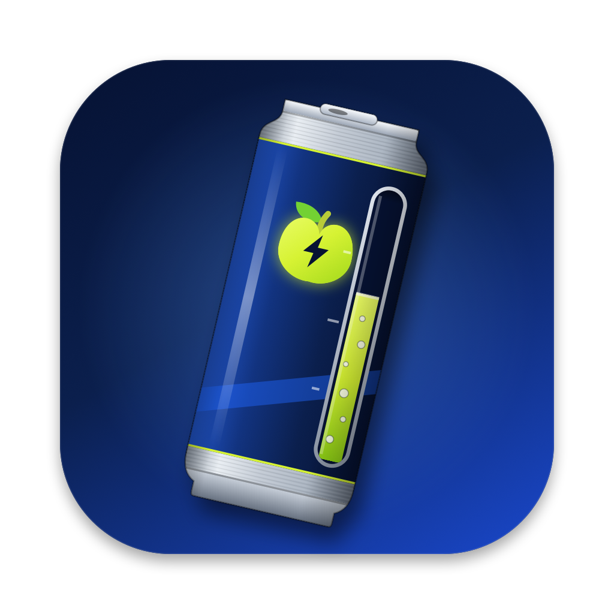
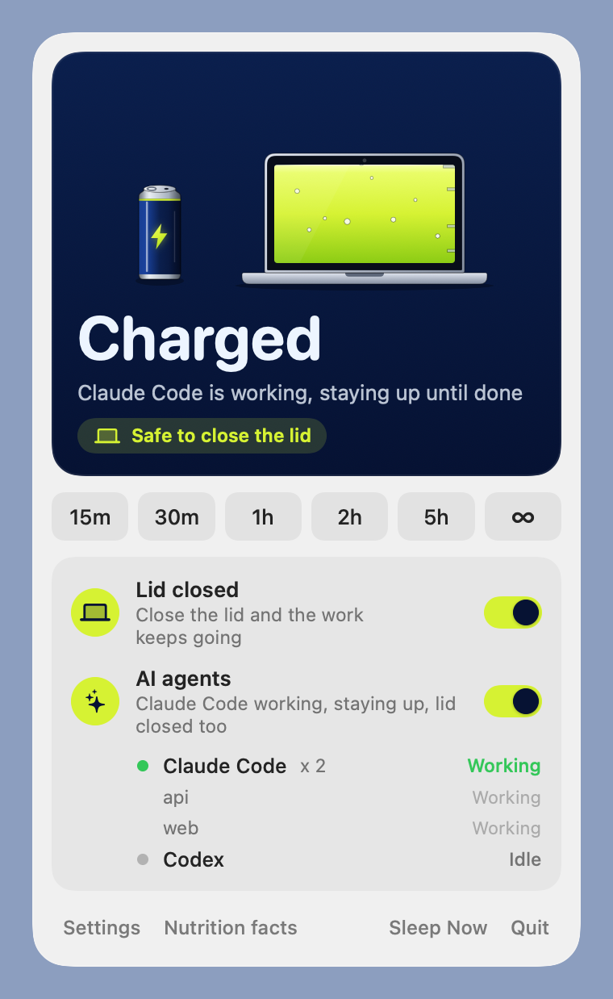
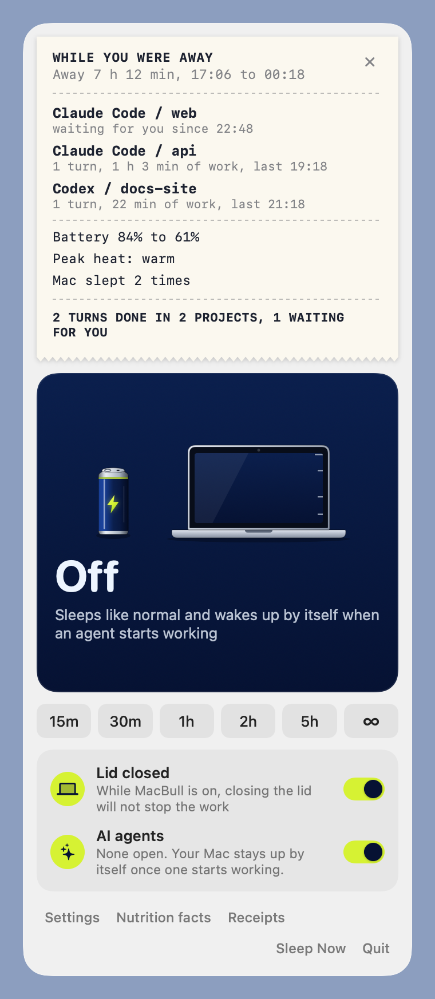
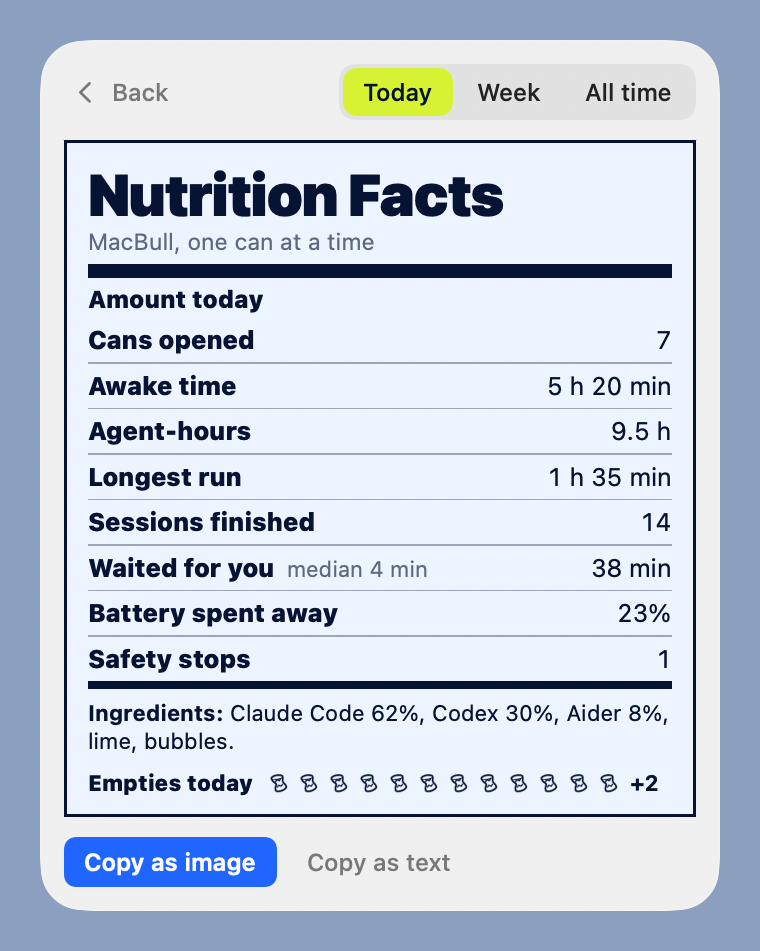

<p align="center">
  
</p>

<h1 align="center">MacBull</h1>

<p align="center">
  Keeps your Mac awake while your AI agents work, lid closed too.<br>
  And taps you on the shoulder when Claude needs you.
</p>

<p align="center">
  <a href="https://github.com/gugestlfavort/macbull/releases/latest"><b>Download the latest release</b></a>
  &nbsp;·&nbsp; macOS 14 Sonoma or later &nbsp;·&nbsp; Apple silicon and Intel &nbsp;·&nbsp; free and open source (MIT)
</p>

<p align="center">
  
  
  
</p>

MacBull is a menu bar app. Its icon is an energy drink can; there is no Dock icon. Drag up on the can to pour in time, or let it notice your coding agents (Claude Code, Codex, Gemini CLI, Cursor Agent, Copilot CLI, OpenCode, Amp, Aider) and stay up exactly as long as they work.

## Install

1. Download `MacBull.zip` from the [latest release](https://github.com/gugestlfavort/macbull/releases/latest) and open it.
2. Drag `MacBull.app` into your **Applications** folder.
3. Open MacBull. macOS says it cannot verify the app is free of malware. Click **Done** (on macOS 14: **OK**).
4. Open **System Settings > Privacy & Security**, scroll down to the message about MacBull and click **Open Anyway**. Confirm with your password.
5. MacBull opens with a short welcome. Look for the can in the menu bar.

You only do steps 3 and 4 once.

**Why the warning?** MacBull is a free hobby project and is not signed with a paid Apple Developer ID, so macOS cannot check it with Apple. The full source is in this repository: you can read it, or build the app yourself (see [Build from source](#build-from-source)).

If you prefer Terminal, this does the same as steps 3 and 4 (it removes the "downloaded from the internet" mark):

```sh
xattr -dr com.apple.quarantine /Applications/MacBull.app
```

### Uninstall

1. If you set up lid-closed mode: Settings > Lid Closed > **Remove permission...**
2. If you turned on Claude Code hooks: Settings > AI Agents, turn them off (this removes MacBull's entries from `~/.claude/settings.json`).
3. Quit MacBull and move it to the Trash.
4. Optional, to remove its history and settings:

   ```sh
   rm -rf "$HOME/Library/Application Support/MacBull"
   defaults delete app.macbull.MacBull
   ```

## What it does

**Keep awake**
- Drop down the panel and pour time into the laptop: drag to a duration, tap a quick pick (15 min, 30 min, 1 h, 2 h, 5 h, until turned off), or use the click shortcut.
- Optionally keeps the display lit too.
- A single "Sleep now" when you are done.

**Agent mode**
- Finds running coding agents: Claude Code, Codex, Gemini CLI, Cursor Agent, Copilot CLI, OpenCode, Amp and Aider, plus scripts you add yourself.
- Judges whether each one is working or only open, and keeps the Mac awake while any works. A grace period after the last one stops avoids flapping.
- Optional Claude Code hooks make that judgement exact for Claude Code (see below).

**Your Turn**
- A badge on the can, a notification and a section at the top of the panel when a Claude Code session waits for you (with hooks on). Click a row to bring the terminal or editor that hosts it to the front.
- A single reminder per wait, and an option to light a sleeping screen once, outside your quiet hours.

**The Receipt**
- When you come back after being away, one summary: which sessions finished, which wait for you, battery from start to end, heat, sleeps and any safety stop. Shown in the panel and as one notification.

**Sound and feel**
- Small sounds and trackpad detents while the panel is open (crack, fizz, clink, crumple), all generated by this repository's own script. Notification sounds for agents done, safety stops and waiting for you. All of it can be turned off.

**Nutrition Facts**
- Your stats on a label: cans opened, awake time, agent-hours, longest run, sessions finished, time agents waited for you, battery spent while away. Copy as image or text. Project names never appear on it.

**Stall Watchdog**
- A session that claims to work but shows no sign of life for 10 minutes is flagged and you get one notification. MacBull never touches the process.

**Safety**
- Stops and lets the Mac sleep when the battery drops below your limit (on battery) or the Mac gets hot, and tells you.

## Build from source

Requires macOS 14+ and the Swift 6 toolchain (Xcode 16 or the matching command line tools).

```sh
swift build            # debug build
swift test             # unit tests
scripts/build-app.sh   # dist/MacBull.app and dist/MacBull.zip (universal, hardened runtime, ad-hoc signed)
```

Set `MACBULL_SIGN_ID` to a Developer ID identity to sign with it instead of ad hoc. The version is read from the `VERSION` file.

Notifications and the login item need the real `.app` bundle; they do nothing under `swift run`.

## Lid-closed mode

macOS has no public switch for "do not sleep when the lid is closed". MacBull uses `pmset disablesleep`, which needs root. You approve it once with an admin password prompt, and from then on it does not ask again.

The one-time setup installs two files:

1. A sudo rule at `/etc/sudoers.d/macbull` with exactly four commands, nothing else (`<user>` is your short account name):

   ```
   <user> ALL=(root) NOPASSWD: /usr/bin/pmset -a disablesleep 1, /usr/bin/pmset -a disablesleep 0, /usr/bin/pmset -b lowpowermode 1, /usr/bin/pmset -b lowpowermode 0
   ```

2. A boot daemon at `/Library/LaunchDaemons/app.macbull.boot-reset.plist` (label `app.macbull.boot-reset`). It runs once at every boot and undoes what MacBull may have left behind after a dead battery or a hard shutdown: it turns `disablesleep` and Low Power Mode back off, but only if MacBull's own flag files say MacBull turned them on.

The flag files are empty files in `~/Library/Application Support/MacBull/` (`sleep-disabled`, `low-power-forced`, `held-in-bag`). They record what MacBull changed so a crash can be undone. Besides the boot daemon there are two more layers: a watchdog while the hold is on, and a cleanup at every launch and quit.

Settings, tab Lid Closed, has a Remove button that undoes all of it (second admin prompt).

### If your Mac won't sleep

If MacBull crashed and the Mac still refuses to sleep, run these in Terminal:

```sh
# Is sleep disabled? Look for SleepDisabled 1
pmset -g | grep -i SleepDisabled

# Turn sleep back on, and Low Power Mode back off on battery
sudo pmset -a disablesleep 0
sudo pmset -b lowpowermode 0
```

To remove everything MacBull installed for lid-closed mode by hand:

```sh
sudo launchctl bootout system/app.macbull.boot-reset
sudo rm -f /etc/sudoers.d/macbull /Library/LaunchDaemons/app.macbull.boot-reset.plist
rm -rf "$HOME/Library/Application Support/MacBull/sleep-disabled" \
       "$HOME/Library/Application Support/MacBull/low-power-forced" \
       "$HOME/Library/Application Support/MacBull/held-in-bag"
```

## URL commands

The URL scheme is `macbull`. Use them from a shell, a shortcut or a launcher.

| URL | Does |
|---|---|
| `macbull://on` | Turn on with the default duration |
| `macbull://on?minutes=45` | Turn on for 45 minutes (1 to 10080). Any other number means until turned off |
| `macbull://off` | Turn off |
| `macbull://toggle` | Turn on or off |
| `macbull://panel` | Open the panel |
| `macbull://settings?tab=away` | Open Settings; tab is `general`, `lid`, `agents`, `safety`, `away` or `about` |
| `macbull://welcome?step=agents` | Open the welcome flow; step is `hello`, `login`, `lid`, `agents` or `done` |

```sh
open "macbull://on?minutes=90"
```

## Claude Code hooks

Off by default. When you turn it on (Settings, tab AI Agents), MacBull:

- writes a small script to `~/Library/Application Support/MacBull/claude-hook.sh`,
- registers it for seven events (`UserPromptSubmit`, `PreToolUse`, `PostToolUse`, `Stop`, `SubagentStop`, `Notification`, `SessionEnd`) in `~/.claude/settings.json`, leaving everything else in that file as it is and keeping a backup next to it (`settings.json.macbull-backup`). If the file is not valid JSON, MacBull leaves it untouched and says so.

The script never blocks, never touches the network and always exits 0. It drops each event as a file for MacBull to read, then MacBull deletes it. Only the session id, event name, working folder and notification type are read. Message text, tool input and transcripts are never stored, logged or journaled. Turning the setting off removes the hooks again.

## Privacy

- MacBull makes no network connections. It has no analytics, no update check and no account.
- Everything stays on your Mac. The journal behind the Receipt and the Nutrition Facts is JSON lines in `~/Library/Application Support/MacBull/journal/`, one file per day, pruned after the number of days you choose (7, 30 or 90). "Erase history" in Settings deletes all of it.
- Project folder names appear in receipts only if you leave "show project names" on, and never on the Nutrition Facts label.

## Project layout

```
Sources/MacBull/
  Contracts/    the seams between modules: state, settings, service protocols
  Engine/       AppModel: every rule of keep-awake, hold, safety, notifications, receipts
  Power/        IOKit assertions, lid-closed mode, system monitor
  Agents/       process scanning, judging, Claude Code hooks
  Journal/      local event journal, receipts, stats
  UI/MenuBar/   menu bar item and panel
  UI/Windows/   Settings, Welcome, sound and feel
  App/          main.swift: wires it all together
Tests/MacBullTests/   unit tests (swift test)
scripts/              app bundle build, icon and sound generators
docs/renders/         screenshots rendered by the tests
```

## Contributing

Issues and pull requests are welcome. Please run `swift test` before you open a pull request.

## Licence

MIT. See `LICENSE`.
